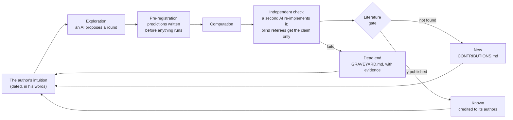

# How the work keeps producing

The results on [`CONTRIBUTIONS.md`](CONTRIBUTIONS.md) come from one loop, run many times. It starts with a
person's intuition, and it ends in one of three places: a new result, a known result credited to its
authors, or a dead end kept with the evidence that killed it.

## Who does what

The loop runs on several kinds of intelligence, each in a fixed role, so the one that proposes never checks
its own work.
- **The author** sets the questions and supplies the intuitions. His words are recorded with their dates, and
  the main directions trace back to them. For example, "void is the center … the always measured from"
  became the void lens and the essay *A Ledger of Nothing*.
- **An exploring assistant** (a claude.ai chat) proposes rounds, writes the predictions down before running
  anything, and computes.
- **A verifying assistant** (Claude Code) re-implements every claim from scratch, in code that shares nothing
  with the first, and reads the literature. It keeps this repository.
- **Blind referees**, separate AI agents, get a claim without the reasoning behind it and try to break it.
- **The literature** decides what is new. Three of our "new" results turned out to be from 1931, 1948 and
  2022, and we say so.

## The record: six days in October 2026

| days | what the loop produced | what it retired or credited to others |
|---|---|---|
| Oct 20–22 | The 880 magic squares of order 4 in binary: every square folds; degree 3 ⟺ invertible; 432 affine squares; the magic Mermin square; order-8 families | Fitting (1931) already had the binary layers, the carries, Nimm0 and the counts |
| Oct 23–24 | Graph-star magic sets: 16 observables at five qubits against a published 26, and the first known sets for odd n ≥ 7. Pairwise balance forces Nimm0. Planes and mirrors | The even-n "records", which hide a smaller contradiction |
| Oct 24 | Round 7: every XOR mask is a reflection about 7.5, and one Walsh proof covers all six singular types | "Singular ⟺ complement" is Dudeney (1917) and Trigg (1948) |
| Oct 24 | Round 8: the determinant of MATLAB's odd magic squares in closed form; every pandiagonal 5×5 square is invertible; the void index | MATLAB's doubly-even rank 3 was proved in 2022 |
| Oct 24–25 | The lower bound: 16 is exactly the minimum at five qubits. The published sets' hidden contradictions. The kernel ledger across six fields | Narrow numerical thresholds, and "4 seen as 5" |
| Oct 25 | The archived J series read again by three independent audits: nine pages came into the towers and the coin, each correcting its source. Two are small new results, on Steiner triple systems and on eight closures of the Equational Theories Project | More than fifty false or unsupported statements in the papers, each kept with its counterexample |

In those six days the loop produced four results at the research frontier and about a dozen smaller ones.
- 44 of 71 pre-registered predictions held. Broad structural predictions mostly held; narrow numerical
  thresholds mostly lost.
- About thirty claims went to the graveyard, each with its evidence.
- Every test suite in the repository still passes.

## The same loop, one level down: September

The loop first ran on the project's own past. In September 2026 two years of AI-assisted research went
through the same gates:
- true, then specific, then not a readout of its own construction;
- a null-model test;
- a census of 56 papers.

Nothing specific to the old tables survived. What survived became this repository: the base, the coin and the
towers, all built on the author's own ideas.

In October the loop ran again, on the ten papers the census had called correct, and found that none of them
quite was: each of the ten contains at least one false or unsupported statement. The evidence is in
[`graveyard/j_series_reread/`](graveyard/j_series_reread/README.md). The census had been too generous, and
the second reading is what caught it. The audit also settled one open question about Tao's Equational
Theories Project, against our own earlier claim: all eight closures it named have finite specimens. That
story is the essay [`WHAT_SURVIVED.md`](WHAT_SURVIVED.md).

## From a child's hands to the research frontier

The same ideas run at every level, and across about a dozen fields. That is the point of the project: a new
way to teach higher mathematics.

| level | what it meets here |
|---|---|
| **A child** with gumdrops and toothpicks | The integers 0–9 as the shapes they are forced to take; a coin with two sides and an edge |
| **School** | The Lo Shu square in four colours; magic squares written in binary; why √2 is missing from the fractions; why a round robin with an odd number of teams has one bye in every round |
| **Undergraduate** | Group actions and orbits; Walsh transforms; the coin's three half-turns of the number sphere; Fejér's kernel; one group, S₄, acting on space in two ways |
| **Graduate** | Clifford algebras, spinors and Bott's clock; contextuality and Pauli groups; valuations in cyclotomic fields |
| **Research** | Open questions answered: the smallest genuine five-qubit magic sets; a closed-form determinant; every pandiagonal 5×5 square invertible |

And across fields:
- number and shape;
- geometry;
- algebra: Clifford algebras, spinors and magmas, and the laws a table obeys;
- representation theory: the two faces of S₄, and the chemist's labels for orbitals;
- combinatorics: magic squares, Latin squares and round robins;
- number theory and linear algebra;
- harmonic analysis: Fejér's kernel;
- quantum foundations: contextuality;
- chemistry: zero modes;
- structures: floppy modes;
- signal processing: Fourier blind spots;
- cryptography: complementation.

Every field is entered through the same question, and every crossing into physics or chemistry is fenced:
it reproduces a known result, and claims nothing beyond it.

## What keeps it honest

1. **Predictions before runs.** Every round writes its predictions and kill conditions down first. Losses
   are scored and kept.
2. **Two implementations.** No result rests on one program. The second is written without reading the first.
3. **Blind referees.** They get the claim, not the argument.
4. **Literature before novelty.** "New" means not found in the sources we name.
5. **A graveyard.** A retraction is a result. [`GRAVEYARD.md`](GRAVEYARD.md) keeps every dead end with its
   evidence.
6. **Watch the yield.** When rounds start coming back as "known", stop, and let the author choose the next
   question.

The longer list of lessons, from the September audit, is in [`WHAT_SURVIVED.md`](WHAT_SURVIVED.md).
