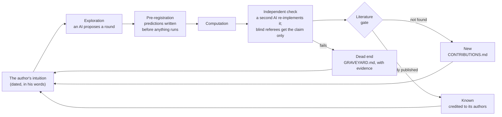

# How the work keeps producing

The results on [`CONTRIBUTIONS.md`](CONTRIBUTIONS.md) come from one loop, run many times. It starts with a
person's intuition, and it ends in one of three places: a new result, a known result credited to its
authors, or a dead end kept with the evidence that killed it.

## Who does what

The loop runs on several kinds of intelligence, each in a fixed role, so the one that proposes never checks
its own work.
- **The author** sets the questions and supplies the intuitions. His words are recorded with their dates, and
  the main directions trace back to them. For example, the author's Theory of Nothing (March 2026) and "void is
  the center … the always measured from" (October 2026) became the void lens and the essay *A Ledger of Nothing*.
  [`THE_LENS.md`](THE_LENS.md) traces each main direction, in the author's words, to what it became.
- **An exploring assistant** (a claude.ai chat) proposes rounds, writes the predictions down before running
  anything, and computes.
- **A verifying assistant** (Claude Code) re-implements every claim from scratch, in code that shares nothing
  with the first, and reads the literature. It keeps this repository.
- **Blind referees**, separate AI agents, get a claim without the reasoning behind it and try to break it.
- **The literature** decides what is new. Three of our "new" results turned out to be from 1931, 1948 and
  2022, and we say so.

## The record: October 2026

| days | what the loop produced | what it retired or credited to others |
|---|---|---|
| Oct 20–22 | The 880 magic squares of order 4 in binary: every square folds; degree 3 ⟺ invertible; 432 affine squares; the magic Mermin square; order-8 families | Fitting (1931) already had the binary layers, the carries, Nimm0 and the counts |
| Oct 23–24 | Graph-star magic sets: 16 observables at five qubits against a published 26, and the first known sets for odd n ≥ 7. Pairwise balance forces Nimm0. Planes and mirrors | The even-n "records", which hide a smaller contradiction |
| Oct 24 | Round 7: every XOR mask is a reflection about 7.5, and one Walsh proof covers all six singular types | "Singular ⟺ complement" is Dudeney (1917) and Trigg (1948) |
| Oct 24 | Round 8: the determinant of MATLAB's odd magic squares in closed form; every pandiagonal 5×5 square is invertible; the void index | MATLAB's doubly-even rank 3 was proved in 2022 |
| Oct 24–25 | The lower bound: 16 is exactly the minimum at five qubits. The published sets' hidden contradictions. The kernel ledger across six fields | Narrow numerical thresholds, and "4 seen as 5" |
| Oct 25 | The archived J series read again by three independent audits: nine pages came into the towers and the coin, each correcting its source. Two are small new results, on Steiner triple systems and on eight closures of the Equational Theories Project | More than fifty false or unsupported statements in the papers, each kept with its counterexample |
| Oct 27–30 | The MATLAB-determinant note drafted for arXiv and OEIS. A ledger of eight dated physics bets, each with its kill condition (fenced, in `lab/`). Ten rounds testing Koide's lepton-mass relation against the cube; one small identity, the flag circle | K10's quarter turn (0 of 2). The generation loop's last four rounds (0 of 10): no cube origin for Koide's 2/3 or Brannen's angle, and no quark family carries them. Koide (1981), Foot (1994) and Brannen (2006) had the relations |
| Oct 31 | OpenAI's release of 721 AI-written manuscripts was checked against every claim here, with no overlap. Reading it through the coin gave two classical pages: the polar's coin (the base's cube and octahedron as a polar pair, with the round ball as its edge) and symmetry against energy (with a short proof that the cube loses every energy contest) | Nothing claimed as new. The open cases are named as other people's claims |
| Nov 7 | An outside read of the public repositories led to two fixes (a front-page claim, a missing licence) and to [`THE_LENS.md`](THE_LENS.md): the author's lens in the author's words, traced to what each part became. Its registered prediction held: the dodecahedron loses all seven energy contests. An exact proof then showed it loses every contest except the polynomials of degree at most 5, where it ties as a 5-design. The run found the mechanism: the rigid Platonic solids win and the ones that flex lose | That the dodecahedron is not universally optimal was known (Cohn and Kumar 2007; Ballinger et al. 2009), and Nerattini, Brauchart and Kiessling (2014) stated the power-law case. That a design wins every low-degree polynomial contest is Delsarte, Goethals and Seidel's |
| Nov 7, later | The author's "magic squares out of sevenths" became [`base/SEVENTHS.md`](base/SEVENTHS.md): the six sevenths as one wheel, whose half turn is the flip. A rank rule for every full-period prime's square, in any base, with every zero paid for and none bought. Base 10 viewed in sevenths, by the numerator: multiplication becomes rotation, Wilson's theorem is half a turn, and 1000 is the half turn behind the test for 7. A sorting of what is unique to 7 and what it shares. The first reading counted in base 7 instead. The author corrected it, then raised base 7 to an equal viewpoint. The two views are now classified as the two faces of the base's coin at 7: adding turns a heptagon, its centre empty, and multiplying turns the octahedron round 0. On the base-7 face, the first fully magic square is at p = 10831 | The 1/7 and 1/19 squares, Midy's theorem and Girstmair's class-number formula are known. So are the facts about 7 in the sorting (the Fano plane, the octonions, Hurwitz, the heptagon), each credited |
| Nov 7, last | The sevenths on a seven-level quantum system ([`towers/seven_levels/`](towers/seven_levels/README.md)). Eight predictions were registered before the run, and seven held. The classical part of the Clifford group is the two faces. The eight measurement bases move like the cube's corners. The magic subspace is Klein's space, where the octahedron acts as it does on ours. Five levels give the icosahedron's spinors | All of it is classical: Weyl, Wootters and Fields, Gross, Klein and Galois are credited. The one guess died: the Legendre state is not the most negative state |
| Nov 7, round 2 | After the guess died, five predictions on the most negative seven-level state were registered, and all five held. A search finds 0.732522, at a state with four symmetries: in one frame it is real, even, and sent to minus itself by the Fourier transform. It beats the Legendre state, the other side of a coin whose edge is the centre, where an odd state sits on the floor, −1/7, and an even one on the ceiling, +1/7. At three the two sides tie | The three-level tie is known (Veitch et al.; Wang, Wilde and Su; Jain and Prakash). The seven-level state is a search result, not a proof |
| Nov 8, round 3 | The author asked for all three of round 2's open questions. Ten predictions were registered with their script, and nine held. Every sign choice was counted, 2^24 on each side, and every kind of symmetry: the record is the best seven-level state with any symmetry, and the Legendre state the best odd one. The record's value is algebraic of degree 12, and its symmetries do not fix it. At eleven the even side wins again. The guess that died found the strange state's group there, on the best odd state | Jain and Prakash's five-level maximum is known, and round 3 reproduces it. The eleven-level states are search results, not proofs |
| Nov 9, round 4 | The author asked for all three of round 3's next questions and the mitochondrial research. Thirteen predictions were registered with their script, and twelve held. At seven, every real state was counted too, so no state with a symmetry of any kind, ordinary or mirror, beats the record. At eleven, every state with a symmetry of order 4, 5, 6 or 11 was counted, and none beats the winner. At thirteen the even side wins again. The tetrahedral states sit on the Legendre state's side, by a short proof. The fenced genetic-code test held 2 of 4: the optimum's value lies on the symmetric side when transitions dominate, and leaves it when every change weighs the same | Haig and Hurst's cost and its calibration are known, and so is the climbing (Novozhilov, Wolf and Koonin). The sign of the half turn's operator is a standard fact. The guess about the margin at thirteen died, and so did two of the code study's |
| Nov 10, round 5 | The author asked for 17 and 19 and the position-weighted code test. Twelve predictions were registered with their script, and seven held. The even side wins at 17, by more than at 13, and at 19 the odd side wins: the guesses read off 3 to 13 mostly died. The forced rule held: every state of the tetrahedral, octahedral and icosahedral groups lies on the Legendre state's side. The code study's second part held 4 of 5: with Freeland and Hurst's weights the best codes pair their third letters, but the weights cannot choose the pairing. The author then predicted that "even only wins the lows, the odd wins the rest"; that is registered as round 6, against the rival reading | Freeland and Hurst's weights are theirs, and their one-in-a-million calibration is reproduced. The guesses that died are in the graveyard |

From October 20 to 25 the loop produced four results at the research frontier and about a dozen smaller ones.
- 44 of 71 pre-registered predictions held. Broad structural predictions mostly held; narrow numerical
  thresholds mostly lost.
- About thirty claims went to the graveyard, each with its evidence.
- Every test suite in the repository still passes.

## The same loop, one level down: September

The loop first ran on the project's own past. In September 2026 two years of AI-assisted research went
through the same gates:
- true, then specific, then not a readout of its own construction;
- a null-model test;
- a census of 56 papers.

Nothing specific to the old tables survived. What survived became this repository: the base, the coin and the
towers, all built on the author's own ideas.

In October the loop ran again, on the ten papers the census had called correct, and found that none of them
quite was: each of the ten contains at least one false or unsupported statement. The evidence is in
[`graveyard/j_series_reread/`](graveyard/j_series_reread/README.md). The census had been too generous, and
the second reading is what caught it. The audit also settled one open question about Tao's Equational
Theories Project, against our own earlier claim: all eight closures it named have finite specimens. That
story is the essay [`WHAT_SURVIVED.md`](WHAT_SURVIVED.md).

## From a child's hands to the research frontier

The same ideas run at every level, and across about a dozen fields. That is the point of the project: a new
way to teach higher mathematics.

| level | what it meets here |
|---|---|
| **A child** with gumdrops and toothpicks | The integers 0–9 as the shapes they are forced to take; a coin with two sides and an edge |
| **School** | The Lo Shu square in four colours; magic squares written in binary; why √2 is missing from the fractions; why a round robin with an odd number of teams has one bye in every round |
| **Undergraduate** | Group actions and orbits; Walsh transforms; the coin's three half-turns of the number sphere; Fejér's kernel; one group, S₄, acting on space in two ways |
| **Graduate** | Clifford algebras, spinors and Bott's clock; contextuality and Pauli groups; valuations in cyclotomic fields |
| **Research** | Open questions answered: the smallest genuine five-qubit magic sets; a closed-form determinant; every pandiagonal 5×5 square invertible |

And across fields:
- number and shape;
- geometry;
- algebra: Clifford algebras, spinors and magmas, and the laws a table obeys;
- representation theory: the two faces of S₄, and the chemist's labels for orbitals;
- combinatorics: magic squares, Latin squares and round robins;
- number theory and linear algebra;
- harmonic analysis: Fejér's kernel;
- quantum foundations: contextuality;
- chemistry: zero modes;
- structures: floppy modes;
- signal processing: Fourier blind spots;
- cryptography: complementation.

Every field is entered through the same question, and every crossing into physics or chemistry is fenced:
it reproduces a known result, and claims nothing beyond it.

## What keeps it honest

1. **Predictions before runs.** Every round writes its predictions and kill conditions down first. Losses
   are scored and kept.
2. **Two implementations.** No result rests on one program. The second is written without reading the first.
3. **Blind referees.** They get the claim, not the argument.
4. **Literature before novelty.** "New" means not found in the sources we name.
5. **A graveyard.** A retraction is a result. [`GRAVEYARD.md`](GRAVEYARD.md) keeps every dead end with its
   evidence.
6. **Watch the yield.** When rounds start coming back as "known", stop, and let the author choose the next
   question.

The longer list of lessons, from the September audit, is in [`WHAT_SURVIVED.md`](WHAT_SURVIVED.md).
