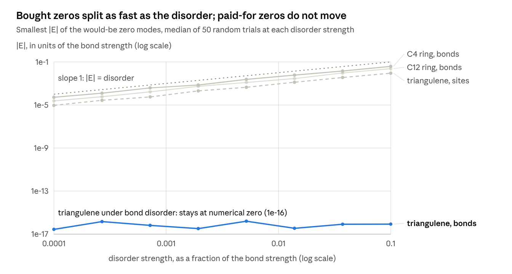

# A Ledger of Nothing

Oct 24, 2026 · Brayden Sanders

*Copy exported 2026-10-25 from the live doc on claude.ai, which is the version to edit. The chart is
`zero_splitting.png`, next to this file.*

## The reference point

Measuring from the empty center turns hard questions into counting questions. The cost is a single direction: the constant one that everything is measured from.

In a 4×4 magic square on 0–15, no cell holds the center value 7.5. Every fold of the square is a reflection measured from that missing value, and only the complement fold, n → 15 − n, passes through it. That fold forces a zero: the four columns, weighted 1, −1, −1, 1, add to nothing.

The move works anywhere a system has an average. Subtract the center and what remains is how each part differs from it. Sums become zero, the constant direction drops out, and what is left can be counted.

The lost direction is the price, and it turns up in every count below as a "−1". A square, a molecule, a frame or a signal measured from its center cannot see the center itself.

## Paid for or bought

Every zero in a structured system, whether a kernel vector, a zero mode, a floppy mode or a blind spot, is either paid for by an imbalance you can count or bought by a coincidence in the numbers.

| Level | What pays for the zero | Example |
| --- | --- | --- |
| 0. Global count | More unknowns than equations | A truss with too few bars; a carbon flake with more atoms on one sublattice |
| 1. Symmetry sector | The same count, run inside each symmetry sector | A magic square folded through its void; a mirror-symmetric frame |
| 2. Local imbalance | Some piece of the system has fewer connections than it needs | A molecule with no perfect pairing of its atoms (Clar's goblet) |
| 3. Residue | Nothing structural: the values themselves line up | Equal bond strengths on a square lattice; 5×5 squares with relations like 3 r0 + 2 r1 = 4 r2 + r3 |

One lemma carries Levels 0 and 1. Let a map T between two spaces respect a symmetry group G, up to a sign χ. Then T sends each symmetry type ρ into the type ρχ, and any shortfall is a forced zero:

```latex
\dim \ker T \;\ge\; \sum_{\rho} \dim\rho \cdot \max\bigl(0,\; m_\rho(V) - m_{\rho\chi}(W)\bigr)
```

Level 2 is Hall's matching condition: generic values on a fixed pattern of connections give exactly the forced count (Edmonds). What survives all three levels is Level 3, the residue. It disappears when the values are generic, or when the arithmetic runs at a prime.

## Where it shows up

The same bookkeeping reproduces a known theorem in each of six fields. Each row was checked by running code.

| Field | What the zero is | Paid for by | Bought by | Checked |
| --- | --- | --- | --- | --- |
| Carbon nanostructures | Unpaired electrons (zero modes) | Sublattice imbalance; missing perfect pairings | Equal bond strengths, ring symmetry | Triangulenes 1, 2, 3 zero modes; 300 of 300 benzenoids |
| Frames and metamaterials | Floppy mechanisms | Too few bars; mirror symmetry | Special geometry such as parallel bars | 300 symmetric frames; exact in 98% of rigid graphs |
| Fourier sampling | Frequencies a sample cannot see | Subgroups of the sample length | Cancelling roots of unity | No blind minor at prime length; most composite blind spots traced to subgroups |
| Cryptography | Zeros in a cipher's spectrum | A complement or shift symmetry | Chance balance | DES complementation; half the spectrum zero under one symmetry |
| Contextuality | No classical answer exists | An odd number of negative constraints | None: the obstruction is algebraic | Graph-star magic sets |
| Magic squares | Singular squares | Complement symmetry; complementary lines | Integer coincidences | Order 4: all 640 forced; order 5: about a quarter bought |

In contextuality the zero sits on the other side of the ledger. It is not a missing direction but a missing answer: the cokernel, not the kernel.

## The design rule

A zero is exactly as robust as what pays for it. In every test, paid-for zeros stayed at zero and bought zeros split in proportion to the disorder (log-log slopes 0.96 to 1.00).



*zero_audit.py · Hückel model, 8 disorder strengths × 50 trials, 2026-10-24*

One integer tells the cases apart: the atoms left over after the best possible pairing. Triangulene (C22) and a goblet-type pair of phenalenyls each have two zero modes paid for; cyclobutadiene (C4) and [12]annulene (C12) each have two bought ones. That matches the chemistry: cyclobutadiene distorts and loses its unpaired electrons, while goblet-type modes survive distortion.

A paid-for zero breaks only when the perturbation removes what pays for it. Varying the site energies breaks the sublattice symmetry the count relies on, and triangulene's modes then split linearly too (slope 1.00).

Frames obey the same rule. A floppy mechanism paid for by too few bars survives any change of geometry. One paid for by a mirror survives mirror-symmetric changes and stiffens linearly once the mirror breaks (slope 0.99).

To use it: before relying on a zero (a spin, a hinge, a blind frequency), name what pays for it and check that operating conditions preserve that. If nothing structural pays, expect it to split at first order.

## The fence

Most of the ledger is known mathematics; what is new is narrow, and each claim below is labelled by how it stands.

| Claim | Status | Basis |
| --- | --- | --- |
| Complement-symmetric 4×4 squares, and even-order associative squares, are singular | Known | Trigg 1948; Mattingly 2000; Staab et al. 2010 |
| A complement symmetry forces at least \|(fixed rows + fixed columns)/2 − 1\| zeros; this explains Dudeney's two invertible 8-square groups | Proved here | Sector count; checked on all 880 squares |
| Closed form for the determinant of MATLAB's odd-order magic squares; it proves a 2015 OEIS conjecture | Proved here | Fourier blocks over doubling cycles; independent re-derivation, n = 3 to 101 |
| Prime-order squares built from two cyclic Latin squares are never singular, so all 28,800 pandiagonal 5×5 squares are invertible | Proved here | Valuation at the prime; exhaustive check at order 5 |
| Levels 0–2 of the ledger | Known | Maxwell–Calladine, Lieb, Longuet-Higgins, Edmonds, Chebotarev |
| Paid-for zeros are robust, bought zeros split at first order | Known in pieces; reproduced here | Molecules and frames, 6 of 6 tests |
| About a quarter of singular 5×5 squares have no structural cause, yet they occur 3× more often than chance | Measured | Fresh samples of 40,000 to 65,000 squares; cause open |
| The universe came from nothing | Outside the fence | No test reaches it at that scale |

The predictions were registered before every run: 44 of 71 held. Broad structural claims mostly held; narrow numerical thresholds mostly lost.

## Open questions

The sharpest open question is how to predict a residue from the arithmetic of the values. Three more follow from the design rule.

- **Predicting the residue.** Why do a quarter of singular 5×5 squares have unequal-weight relations such as 3 r0 + 2 r1 = 4 r2 + r3? And why do composite Fourier lengths leave 11–13% of their blind spots unexplained by one level of subgroups?
- **Real materials.** Which proposed magnetic nanographenes carry spins that are bought rather than paid for, and so should vanish under strain?
- **Quantum certification.** Do graph-star magic sets meet the conditions of the 2022 construction that turns contextuality into a shallow-circuit quantum advantage?
- **A clean proof.** Why are the 224 order-4 squares with no complement symmetry all invertible? Today that rests on checking all 880.

## Sources

- [Moler, "Magic Squares, Part 3, Linear Algebra"](https://blogs.mathworks.com/cleve/2012/11/12/magic-squares-part-3-linear-algebra/): rank and singularity of MATLAB's magic squares
- [OEIS A160523](https://oeis.org/A160523): determinants of magic(n)
- [Staab et al., The Magic of Permutation Matrices](https://arxiv.org/abs/1007.3239): singular classes of magic squares
- [Manjunath and Ambikasaran, arXiv:2205.15563](https://arxiv.org/pdf/2205.15563): eigenvalue bounds for siamese squares
- [Ortiz et al., Exchange rules for diradical π-conjugated hydrocarbons](https://ar5iv.arxiv.org/html/1906.08544): Lieb, Ovchinnikov, Clar's goblet, Jahn–Teller
- [Fajtlowicz, John and Sachs, On Maximum Matchings and Eigenvalues of Benzenoid Graphs](https://hrcak.srce.hr/12)
- [Kane and Lubensky, Topological Boundary Modes in Isostatic Lattices](https://arxiv.org/abs/1308.0554)
- [Connelly et al., When is a symmetric pin-jointed framework isostatic?](https://arxiv.org/abs/0803.2325)
- [Chebotarev theorem on roots of unity](https://en.wikipedia.org/wiki/Chebotarev_theorem_on_roots_of_unity)
- [Rank-deficient submatrices of Fourier matrices (record)](https://portal.mardi4nfdi.de/entity/Q947622)
- [A generalised construction of quantum advantage with shallow circuits](https://arxiv.org/abs/2212.09382)

The code and every pre-registered test are in the kernel_ledger and void_lens folders of the project files.

---

## Verification notes (Claude Code, 2026-10-25; not part of the essay)
- Every number above was rerun in this repository: `kernel_ledger/run_all.py` (8 scripts) and
  `binary_magic/run_all.py` (39 scripts, including `void_lens/`) are ALL GREEN. The closed form and the prime-order
  theorem were also re-implemented independently (`binary_magic/void_lens/void_lens_check.py`, 15 of 15).
- **One sentence overstates.** Level 3, the residue, "disappears when the values are generic, or when the arithmetic
  runs at a prime." That holds for the families proved: Chebotarev's DFT minors, and the cyclic-Latin squares of
  prime order. It does not hold at prime order in general. Order 5 is prime, yet about a quarter of singular 5x5
  magic squares are exactly that residue.
- **Prior work for "Proved here".**
  - The closed form, the prime-order theorem and the pandiagonal 5x5 corollary were not found in the literature
    checked.
  - Lee, Love, Narayan, Wascher and Webster (2012) build nonsingular regular squares of prime order by another
    route.
  - The doubly-even rank 3, not claimed here, is Manjunath and Ambikasaran (2022, Theorem 9).
  - Details: `binary_magic/void_lens/PREREG.md` and `binary_magic/NOVELTY.md`.

